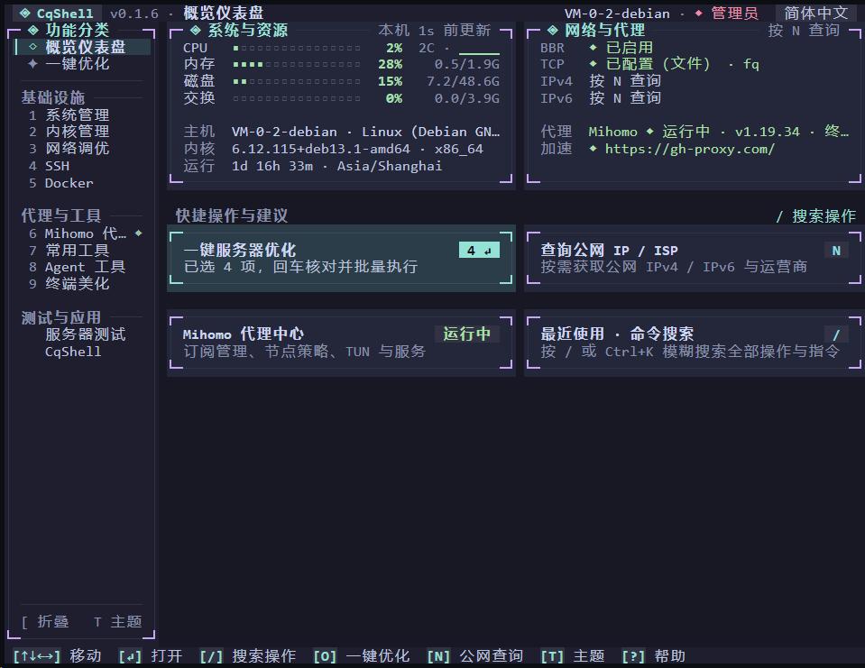
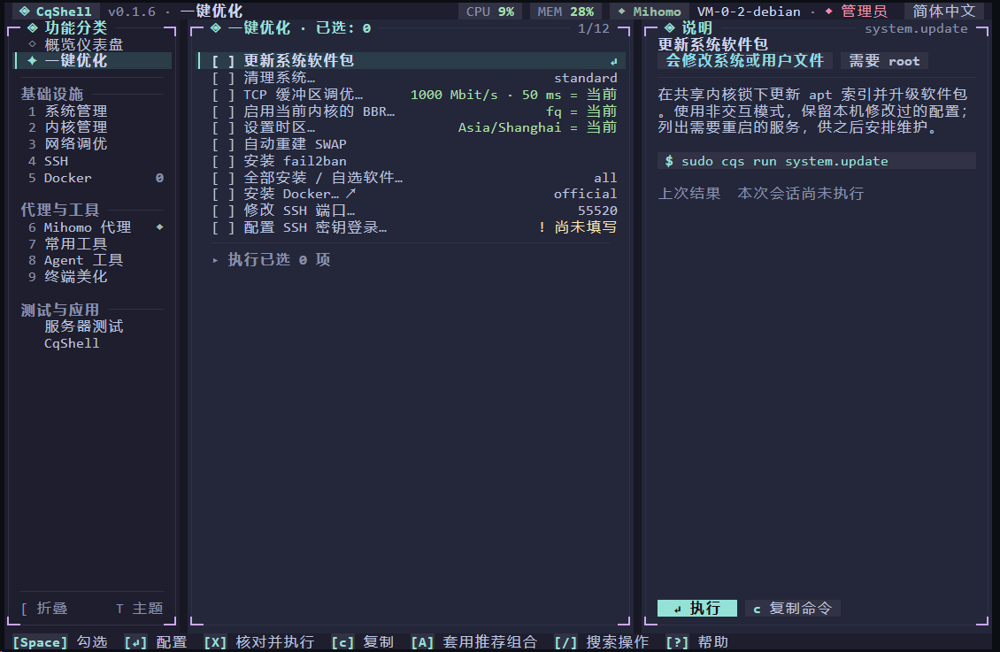
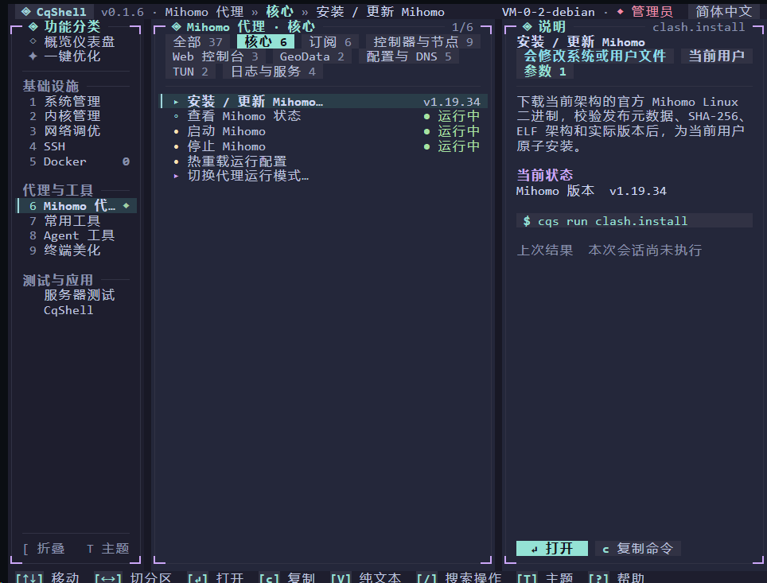
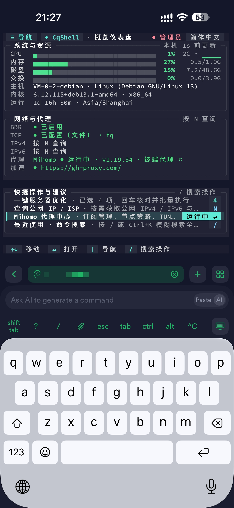
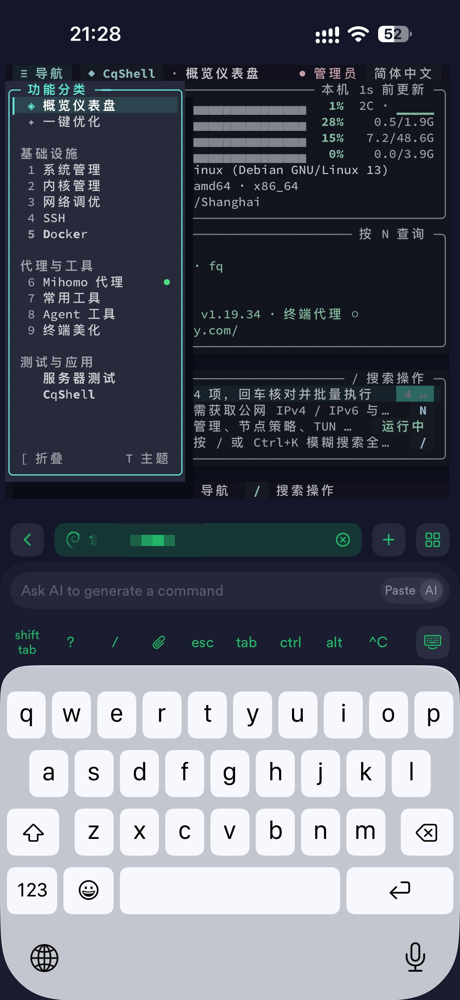

<div align="center">

# CqShell

**面向 Debian / Ubuntu 的现代化 Rust 终端服务器工具箱（TUI & CLI）**

[](https://github.com/ZyphrZero/CqShell/releases/latest)
[](https://github.com/ZyphrZero/CqShell/releases)
[](Cargo.toml)
[](LICENSE)

简体中文 | [English](README.en.md)

[界面预览](#界面预览) · [快速安装](#快速安装) · [功能一览](#功能一览) · [Docker 工作台](#docker-专属-tui-工作台) · [TUI 交互与主题](#tui-交互与主题) · [CLI 编排](#cli-与自动化编排) · [友情链接](#友情链接)

</div>

---

**CqShell（`cqs`）** 是一个单二进制分发的 Rust / Ratatui 服务器运维工具箱，将系统维护、软件源测速换源、BBRv3 内核管理、TCP 调优、SSH 加固、专属 Docker 工作台、Mihomo 全栈代理、AI Agent 工具安装、终端美化与服务器体检收拢于一套高响应、可回滚的双语终端界面与自动化 CLI 中。

## 界面预览

### 桌面端 TUI（概览仪表盘 · 一键优化 · Mihomo 代理工作台）

<p align="center">
  
</p>

<table>
  <tr>
    <td align="center" width="50%">
      <br />
      <sub>一键优化批处理清单与实时状态对比</sub>
    </td>
    <td align="center" width="50%">
      <br />
      <sub>Mihomo 代理工作台 · 分区胶囊与命令预览</sub>
    </td>
  </tr>
</table>

### 移动端响应式适配（iOS Termius 竖屏 + 软键盘）

<table>
  <tr>
    <td align="center" width="50%">
      <br />
      <sub>自动切换堆叠概览卡片与紧凑快捷操作列表</sub>
    </td>
    <td align="center" width="50%">
      <br />
      <sub>可随时呼出/收起的浮层导航抽屉（按 <code>[</code> 或点击左上角）</sub>
    </td>
  </tr>
</table>

## 核心特性

- **开箱即用，零运行时依赖**：发布版提供 **Linux x86_64 / ARM64** 静态 musl 可执行文件，无需安装 Rust、Python 或 Node.js，内置完整简体中文与英语词典。
- **现代侧边栏工作台 TUI**：独立 Bento 概览仪表盘、可折叠导航栏、增强命令面板（`/` / `Ctrl+K`）、无边框纯文本复制视图（`V`）与完整键鼠操作；4 档响应式布局最低兼容 **`40×16`**（含 iOS Termius 等移动端窄屏 SSH）。
- **配色 × UI 样式双维解耦**：内置 **8 套配色方案 × 8 套 UI 设计语言**，支持自动探测终端深浅色、实时预览抽屉（`T`）、透明背景（`B`）、减弱动效（`M`）与自定义 TOML 主题。
- **专属 Docker 6 标签工作台**：内置 `cqs docker` 全屏聚焦 / 侧栏嵌入双态管理界面，覆盖容器、Compose、镜像、卷、网络与守护进程；纯原生 CLI JSON 采集，零后台驻留开销。
- **100 项结构化运维动作**：11 大功能模块 + 固定置顶的「一键优化」批处理清单，CLI 与 TUI 共用同一套参数校验、权限检查与执行引擎。
- **事务化安全边界**：全链路 HTTPS + SHA-256 校验、文件锁（`flock`）、配置预检、原子替换、before-image 恢复基线、非交互 `apt` 保护与分级口令确认；任何场景下均不会静默重启系统。

---

## 快速安装

普通用户无需安装 Rust。安装脚本会自动识别架构、通过 HTTPS 下载并校验 SHA-256 与二进制版本，默认提供交互式目录选择（`/usr/local/bin`、`$HOME/.local/bin` 或自定义路径，直接回车保持 `/usr/local/bin`）。

### 方式一：国内加速网关安装（推荐国内服务器）

更换加速网关时，只需修改第一行的 `GH_PROXY` 地址（末尾有无 `/` 均可；已是 root 用户时去掉 `sudo`）：

```bash
GH_PROXY="https://gh-proxy.org"
curl -fsSL "${GH_PROXY%/}/https://raw.githubusercontent.com/ZyphrZero/CqShell/main/install.sh" | sudo bash -s -- --gh-proxy "$GH_PROXY"
```

> [!NOTE]
> 请选择你信任的 HTTPS 网关。`--gh-proxy` 覆盖安装阶段的版本查询、安装包与校验文件下载，不修改系统代理；也可传入 `--gh-proxy default` 使用内置预设 `https://gh-proxy.com/`。

### 方式二：GitHub 直连安装

```bash
curl -fsSL https://github.com/ZyphrZero/CqShell/releases/latest/download/install.sh | sudo bash
```

### 启动、升级与卸载

```bash
cqs --lang zh-CN          # 启动交互式 TUI（只读浏览 / 用户级操作）
sudo cqs --lang zh-CN     # 以 root 权限管理整机系统操作
cqs docker                # 直接进入全屏 Docker 管理工作台
cqs mihomo                # 直接进入全屏 Mihomo 代理可视化工作台
sudo cqs update           # 校验并原子自更新到最新稳定版
sudo cqs --uninstall      # 卸载默认命令（保留配置与恢复基线）
```

<details>
<summary>安装器进阶参数、手动下载与从源码构建</summary>

#### 安装器依赖与进阶参数

目标主机需具备 `bash`、`curl`、`ca-certificates`、`tar`、`gzip` 与 `coreutils`（缺失时可执行 `sudo apt-get update && sudo apt-get install -y curl ca-certificates tar gzip coreutils`）。

将下列参数追加到安装命令末尾（位于 `bash -s --` 之后）：

| 用途 | 追加参数 |
| --- | --- |
| 指定版本（网关不支持 API、限流或需安装旧版/预发布版时） | `--version v0.1.8` |
| 安装到自定义绝对路径 | `--install-dir /opt/cqs` |
| 安装到当前用户目录（同时去掉 `sudo`） | `--install-dir "$HOME/.local/bin"` |

安装到用户目录后，可执行 `export PATH="$HOME/.local/bin:$PATH"` 加入 `PATH`。重复执行安装命令或运行 `sudo cqs update` 均可平滑升级，失败时保留原有程序，配置与恢复记录不受影响。

#### 从 GitHub Releases 手动校验安装

```bash
sha256sum --check cqs-x86_64-unknown-linux-musl.tar.gz.sha256
tar -xzf cqs-x86_64-unknown-linux-musl.tar.gz
./cqs/cqs --lang zh-CN
```

#### 从源码构建（Linux / Windows）

在 Debian / Ubuntu 上使用 **Rust 1.88+** 及 C 编译工具链构建：

```bash
cargo build --release --locked
./target/release/cqs --lang zh-CN
sudo ./target/release/cqs --install   # 显式安装到 /usr/local/bin/cqs
```

Windows PowerShell 也可直接编译并运行界面预览与 CLI 元数据检查（系统写操作仍仅限 Debian / Ubuntu；重编译遇到文件锁定时请先在旧界面按 `Q` 退出）：

```powershell
cargo build --release --locked
.\target\release\cqs.exe --lang zh-CN
```

更多发布与镜像源规范见 [docs/RELEASING.md](docs/RELEASING.md)。

</details>

---

## 功能一览

侧边栏顶部固定 **概览仪表盘（`H`）** 与 **一键优化（`O`）**，下方包含 11 个可自由调整顺序的功能模块（共 **100 项** CLI/TUI 操作）：

| 模块 | 覆盖能力 |
| --- | --- |
| **一键优化** | 勾选式批量配置清单；按 `A` 一键套用「系统更新 + 标准清理 + TCP 调优 + BBR」推荐组合，统一核对并逐项展示进度与用时 |
| **系统管理** | 系统概览、按需公网 IP/ISP 查询、非交互 apt 更新与清理、**LinuxMirrors 测速换源与还原**、时区设置、SWAP 管理、`fail2ban` |
| **网络调优** | BBR 状态检测、4 种队列调度（`fq` / `fq_codel` / `fq_pie` / `cake`）、带宽/RTT/cgroup 内存感知 TCP 调优与撤销、**GitHub 国内加速代理** |
| **内核管理** | BBRv3 Standard / Max 内核安装（最新匹配或指定 `x.y.z`）、已安装内核列表、**GRUB 单次切核启动**、安全卸载未运行第三方内核 |
| **SSH** | 端口修改与真实监听校验（兼容 `Match`/`Include`）、导入公钥并关闭密码认证 |
| **Docker** | **专属 6 标签 TUI 管理工作台**（容器/Compose/镜像/卷/网络/守护进程）+ 安装、镜像源、IPv6、清理与卸载 |
| **常用工具** | `curl`、`wget`、`nano`、`unzip`、`tar`、`tmux`、`iftop`、`btop`、`gdu`、`fzf`、`git`、`gh` 独立入口与一键全装 |
| **Agent 工具** | **Pi（`pi.dev`）**、**Claude Code**、**Codex CLI** 官方独立二进制安装/更新与版本巡检（零 Node.js/npm） |
| **终端美化** | Starship + Bash/Zsh 提示符配置，7 种样式 × 9 套配色，TUI/CLI 只读效果预览、TOML 查看与首次基线还原 |
| **Mihomo 代理** | **专属 6 标签可视化工作台（`cqs mihomo`）** + 41 项全栈动作：核心、在线/本地订阅与配额热重载、策略组测速排序、实时连接与规则、4 款 Web 面板、SOCKS5 凭据卡、DNS/TUN/systemd 与 `clashctl` 兼容 |
| **服务器测试** | Speedtest、**xykt/IPQuality**（默认隐私模式）、**ipforai.cc AI 服务检测**（默认关闭短链上传）、NextTrace、YABS、网络连通性与磁盘 I/O 测试 |
| **CqShell** | 在线版本检查、校验式原子自更新、`cqs` 系统命令安装与卸载 |

---

### Docker 专属 TUI 工作台

在主界面选择侧边栏 **Docker**，或直接运行 `cqs docker [--tab containers|compose|images|volumes|networks|daemon] [--embedded]`：

- **双态与全屏聚焦**：支持侧栏嵌入与全屏聚焦（`z` / `F`）无缝切换，聚焦态 `1–6` 直达 6 个资源标签页，按 `[` 随时呼出侧栏。
- **全栈运维闭环**：
  - **容器**：`s` 启停、`u` 重启、`p` 暂停、`e` / `Shift+E` 进入原生 `docker exec -it` 交互终端、`Space` 多选批量操作、`l` 实时流式/全屏日志、`m` 实时 CPU/内存 Sparkline 与 `docker top`、`v` 环境与挂载检查（敏感凭据默认脱敏，`Shift+S` 临时显隐）。
  - **Compose**：项目与服务拓扑、关联容器联动、聚合日志、YAML 只读预览及 `Up / Stop / Restart / Pull / Down`。
  - **镜像 / 卷 / 网络 / 守护进程**：镜像拉取与层级历史、`g` 快捷键一键配置镜像加速源（内置常用预设 / 逗号分隔多源故障转移 / `clear` 恢复直连）、卷与网络引用保护、可视化空间回收 Prune 向导（`Shift+P`），并将安装、镜像源、IPv6、清理与卸载统一整合至「守护进程」页。
- **零重依赖与分级确认**：全程基于原生 `docker` / `docker compose` JSON 输出（天然兼容 Rootless、`DOCKER_HOST` 与 Context），离开 10 秒后后台监控自动休眠；卷删除、批量删除 ≥3 项与含卷 Prune 均需输入口令（`REMOVE` / `PRUNE`）确认。

---

### Mihomo 代理与 `clashctl` 兼容

在主界面选择侧边栏 **Mihomo 代理**，或直接运行 `cqs mihomo [--tab overview|proxies|profiles|connections|rules|tools] [--embedded]` 进入 6 标签可视化工作台（纯 Rust 实现，含 41 项 CLI/TUI 操作），默认数据目录位于 `${XDG_DATA_HOME:-$HOME/.local/share}/cqs/clash`（支持 `CQS_CLASH_*` 环境变量覆盖）：

- **可视化 6 标签工作台**：支持侧栏嵌入与 `z`/`F` 全屏聚焦，涵盖**仪表盘**（速率/Sparkline 曲线、模式持久化切换、按需手动出口 IP 探测）、**代理**（可滚动策略组胶囊 + 多列节点卡片、整组/单节点测速、多维排序、隐超时、选最快、自动组固定/恢复）、**配置**（`subscription-userinfo` 流量进度与到期日、热重载与失败四文件原子回滚、批量更新与外部 Providers）、**请求**（运行中/200 条已关闭/全部与规则胶囊筛选）、**规则**与**工具**（运维表单聚合 + 内嵌脱敏日志搜索与复制）。

- **核心与订阅事务**：官方二进制校验安装、HTTPS 在线订阅与本地 YAML 导入（`clash.sub.import`），提交前自动合并 Mixin 并执行 `mihomo -t` 校验，多文件事务保留 before-image 回滚。
- **可视化 SOCKS5 / SOCKS5h 独立入站**：内置 `clash.socks.*` 专属分栏预览表单，一键配置独立 `cqs-socks5` 监听端口、绑定地址（`0.0.0.0` / `::` / `127.0.0.1` / 指定网卡 IP）、UDP 转发及出站模式（`DIRECT` 本机直连落地或跟随分流规则）；非回环监听强制强密码认证，自动生成 `0600` 私有连接凭据卡（`socks5.auth`，含 `socks5h://` 与 `socks5://` 连接串），Mihomo 运行中且配置控制器时支持零停机热重载。
- **4 款 Web 控制台**：内置 **Zashboard**（默认）、**MetaCubeXD**、**Yacd-Meta** 与 **Razord-Meta** 的签名/摘要校验安装与切换卸载；默认绑定回环地址，推荐通过 SSH 端口转发访问。
- **实时控制器与 GeoData**：零外部进程直连控制器，支持配置热重载（失败回滚）、`rule/global/direct` 模式切换、策略组并发测速排序、活跃连接巡检与断开，以及 `MetaCubeX/meta-rules-dat`（`standard`/`lite`/`full`）规则库校验更新。
- **高级配置与托管**：事务化管理核心端口/嗅探/日志级别、DNS（`fake-ip`/`redir-host` 与国内外 DoH 预设）、Mixin 脱敏查看与重置、TUN 模式与 systemd 用户/系统服务托管。
- **Shell 代理与 `clashctl` 兼容**：

```bash
# 当前 Shell 注入 / 清理代理环境变量（支持 bash / zsh / fish）
eval "$(cqs proxy-env on --shell bash)"
eval "$(cqs proxy-env off --shell bash)"

# 兼容 nelvko/clashctl 常用命令习惯（不修改 Shell 配置文件）
eval "$(cqs clashctl shell-init --shell bash)"
clashctl on && clashctl status
clashctl node use 'Proxy' 'Node A'
```

完整命令、权限边界与恢复说明见 [docs/MIHOMO.md](docs/MIHOMO.md)。

---

### Agent 工具、常用工具与终端美化

- **Agent 工具（零 Node.js / npm）**：统一直接安装 **Pi（`pi.dev`）**、**Claude Code**、**Codex CLI** 的官方 Linux x86_64 / ARM64 独立二进制，不执行远程安装脚本。安装前展示目标版本与 SHA-256，校验摘要、ELF 架构、包结构及实际 `--version` 后原子切换至 `~/.local/bin`（版本文件存于 `~/.local/share/cqs/ai/<tool>/`，自动备份旧入口且不修改 Shell 配置）。请以实际使用用户直接执行（**不加 `sudo`**，直接 root 登录除外）：

  ```bash
  cqs run ai.pi.install
  cqs run ai.claude.install
  cqs run ai.codex.install
  cqs run ai.status
  ```

- **常用工具与终端美化**：12 个常用工具（含 `git` 及 `cli/cli` 官方 `.deb` 校验安装的 `gh`）支持独立入口或 `tools.install` 全量安装；**终端美化**基于 Starship，提供 7 种样式（`full`、`compact`、`box`、`ribbon`、`powerline`、`minimal`、`brackets`）与 9 套配色（`cyan`、`green`、`magenta`、`tokyo-night`、`catppuccin`、`rose-pine`、`nord`、`gruvbox`、`dracula`），在 TUI 与 CLI 均支持实时效果预览、Starship TOML 检视与首次基线还原。

---

### 系统换源、内核调优与服务器体检

- **系统软件源（LinuxMirrors）**：支持官方源、清华（`tuna`）、中科大（`ustc`）、阿里云（`aliyun`）及 `auto` 真实下载测速推荐；固定上游脚本版本并校验摘要，保留官方安全更新源，支持一键还原（详见 [docs/MIRRORS.md](docs/MIRRORS.md)）。
- **BBR / BBRv3 与 TCP 调优**：在当前内核直接启用 BBR 及队列算法，或安装 BBRv3 Standard / Max 内核；安装后展示目标内核与验证步骤，由用户决定是否手动重启，支持 GRUB 单次切核与未运行内核卸载。
- **GitHub 国内加速代理**：默认关闭；可通过 TUI 快捷键 `P`、`cqs run github.proxy`、`--gh-proxy` 或 `CQS_GH_PROXY` / `GH_PROXY` 开启（预设 `https://gh-proxy.com/`）。仅重写官方 HTTPS GitHub 域名，`api.github.com` 遇限流时自动回退直连，不转发非 GitHub 域名与订阅链接。
- **IP 质量体检（xykt/IPQuality）**：支持双栈 / 仅 IPv4 / 仅 IPv6，跟随中英文界面语言；默认传入 `-p` 关闭在线报告上传并隐藏完整 IP，脚本经固定版本 SHA-256 与语法检查后执行（详见 [docs/IPQUALITY.md](docs/IPQUALITY.md)）。
- **AI 服务检测（ipforai.cc）**：通过 HTTPS 拉取 `https://ipforai.cc/sh` 并经 `sh -n` 语法校验后运行，只读排查公网出口画像、Claude / ChatGPT / Gemini / Grok 网页与 API 分流、IPv6 泄漏、本机 DNS、遥测鉴权域名与双端 RTT；可选标准/扩展/摘要/论坛 Markdown 模式及指定 IP 查询，默认传入 `--no-share` 关闭在线分享短链上传。

---

## TUI 交互与主题

### 界面交互特点

- **独立概览仪表盘（`H`）**：顶部保留 1 行微状态条，主区域 Bento 卡片呈现本机 CPU / 内存 / 磁盘 / SWAP、内核、BBR/TCP、终端代理与 Mihomo 状态（每 3 秒后台自动刷新；公网 IP/ISP 仅在按 `N` 时按需查询，启动不联网）。
- **无需手敲已有对象**：选择订阅、策略组与节点、待切换或删除的内核时，表单自动读取本机现状并弹出支持即时打字筛选的选择器列表。
- **高效文本复制**：所有信息、确认与日志面板均支持鼠标拖选复制，也可按 `C` / `Y` 一键复制命令或日志，或按 `V` 打开无边框纯文本视图直接原生选中。

### 主界面快捷键

| 按键 | 功能 |
| --- | --- |
| `↑↓` / `j k` / `Home` / `End` | 在当前模块的操作列表中移动 |
| `←→` / `PgUp` / `PgDn` | 切换模块内分区 / 滚动详情与日志 |
| `Tab` / `1–9` / `H` / `O` | 切换功能模块 / 跳转编号模块 / 返回概览 / 进入一键优化 |
| `[` | 展开或折叠左侧导航栏（窄屏下切换浮层抽屉） |
| `/` 或 `Ctrl+K` | 打开全局增强命令面板（模糊搜索操作、最近使用与界面指令） |
| `Enter` | 查看详情、配置参数或执行操作 |
| `Space` / `X` / `A` | 一键优化页：勾选项目 / 核对并执行清单 / 套用推荐优化组合 |
| `Alt+↑` / `Alt+↓` | 空闲时调整普通功能模块排序并自动持久化 |
| `T`（抽屉内 `B` / `M`） | 打开右侧「外观与主题」双标签预览抽屉（切换透明背景 / 减弱动效） |
| `P` | 快捷配置 GitHub 国内加速代理 |
| `R` / `N` | 手动刷新本机指标 / 按需后台查询公网 IP 与 ISP |
| `C` / `Y` / `V` | 复制命令或日志 / 打开无边框纯文本视图 |
| `G` / `F2` | 展开或收起底部任务日志 / 打开全屏完整日志 |
| `L` | 切换并保存界面语言（简体中文 / English） |
| `?` / `F1` | 打开上下文快捷键速查 |
| `Esc` / `Q` / `Ctrl+C` | 关闭弹层或取消运行中任务 / 清理后安全退出 |

<details>
<summary>Docker 专属工作台快捷键</summary>

| 按键 | 功能 |
| --- | --- |
| `←→` 或聚焦态 `1–6` | 切换 容器 / Compose / 镜像 / 卷 / 网络 / 守护进程 6 大标签页 |
| `j k` / `Space` / `/` / `a` / `o` | 移动选择 / 多选 / 过滤 / 切换显示全部 / 轮换排序 |
| `Enter` / `s` / `u` / `p` / `e` / `d` / `Shift+P` | 动作菜单 / 启停 / 重启 / 暂停或拉取 / `exec` 终端 / 删除 / Prune 向导 |
| `i` / `l` / `m` / `v` / `J` / `Shift+S` | 概览 / 实时日志 / 指标与 `top` / 环境与挂载 / 切 JSON / 显隐敏感凭据 |
| `f` / `t` / `w` / `c` / `Shift+M` / `y` | 日志内：跟随 / 时间戳 / 软换行 / 清屏 / 划选模式 / 复制 |
| `z` / `[` / `Ctrl+K` / `Shift+T` / `Shift+L` | 全屏聚焦切换 / 侧栏抽屉 / 全局搜索 / 主题 / 语言 |

</details>

### 解耦配色与 UI 设计样式

CqShell 将外观拆分为 **`theme`（配色方案）** 与 **`style`（UI 设计语言）** 两个独立维度。将 `style` 设为 `auto` 时会随配色自动启用专属推荐样式，也可随时在 `T` 抽屉或 CLI 中自由混搭：

| 配色 ID | 名称 | 默认推荐样式 | 风格特点 |
| --- | --- | --- | --- |
| `auto` | 自动适配 | `rounded` 现代圆角 | 自动探测终端深浅背景并派生满足 WCAG 对比度的多层色阶 |
| `obsidian` | 曜石 | `bento` 悬浮层叠 | 深邃暗黑 Bento 无硬外框，纯靠多层表面色阶与呼吸条分层 |
| `daylight` | 澄明 | `editorial` 极简杂志 | 洁净浅色瑞士排印，留白克制、顶部粗体标题与精致横线 |
| `tokyo-night` | 东京夜 | `hud` 精密角框 | 赛博 HUD 四角角标、菱形状态符、分段刻度进度条与流光 |
| `catppuccin` | 摩卡 | `studio` 柔光顶栏 | 柔润暖暗灰表面与卡片顶部柔光标题色带 |
| `rose-pine` | 玫瑰松 | `atelier` 锐角书斋 | 利落直角框、`[ 标题 ]` 标头与点线分隔 |
| `high-contrast` | 高对比 | `heavy` 粗框反色 | 纯黑底、加粗边框与高对比反色选中（无障碍友好） |
| `plain` | 朴素 | `ascii` 纯文本 ASCII | 终端默认色与纯 ASCII 字形，适用于 IPMI / 串口控制台 |

- **优先级**：`--theme` > `CQS_THEME` > `config.toml` > `auto`；`--style` > `CQS_STYLE` > `config.toml` > `auto`。
- **串口 / IPMI 安全模式**：`cqs --theme plain --lang en-US`。
- **自定义主题**：将 `*.toml` 置于 `$XDG_CONFIG_HOME/cqs/themes`（默认 `~/.config/cqs/themes`），颜色角色与完整格式见 [docs/THEMES.md](docs/THEMES.md)。

### 配置文件与多语言

配置文件默认位于 `${XDG_CONFIG_HOME:-$HOME/.config}/cqs/config.toml`（完整模板见 [config.example.toml](config.example.toml)）：

```toml
language = "zh-CN"
theme = "auto"
style = "auto"
transparent_bg = false
reduced_motion = false
sidebar_collapsed = false
detect_background = true
# locale_dir = "/absolute/path/to/locales"
# github_proxy_enabled = false
# github_proxy = "https://gh-proxy.com/"
```

语言优先级：`--lang` > `CQS_LANG` > `config.toml` > `LC_ALL` / `LC_MESSAGES` / `LANG` > 英语。内置中英文翻译已编译进二进制，扩展第三方翻译见 [docs/I18N.md](docs/I18N.md)。

---

## CLI 与自动化编排

所有操作 ID 不随语言变化，无终端环境下可直接使用 CLI，配合 `--yes` / `-y` 自动确认通用提示：

```bash
# 查看元数据、主题与版本更新
cqs list --json
cqs themes && cqs styles
cqs update --check --json
sudo cqs --gh-proxy default update

# 系统换源、BBR 与 TCP 调优
cqs run system.mirror.test
sudo cqs run system.mirror.apply --set mirror_site=auto
sudo cqs run bbr.enable --set qdisc=fq
sudo cqs run tcp.tune --set bandwidth=1000 --set rtt=80

# 批量编排（统一确认一次，按顺序执行）
sudo cqs batch system.update tcp.tune bbr.enable --set tcp.tune.rtt=80

# 内核管理与服务器体检
cqs run kernel.list
sudo cqs run kernel.install --set profile=standard
cqs run test.ip --set ip_family=ipv4
cqs run test.ai --set report_mode=detail

# 常用工具与终端美化
sudo cqs run tools.tmux
cqs run terminal.preview --set style=all --set color=tokyo-night
cqs run terminal.apply --set shell=bash --set style=box --set color=tokyo-night

# Mihomo 代理核心与面板
cqs run clash.status
cqs --yes run clash.sub.add --set name=home --set url=https://example.invalid/sub --set use=on
cqs --yes run clash.panel.install --set panel=zashboard
cqs --yes run clash.start
```

---

## 安全与使用边界

- **平台范围**：系统运维动作仅支持 **Debian / Ubuntu Linux**；BBRv3 内核安装要求 Debian 12+ / Ubuntu 24.04+（amd64 / arm64）、独立内核环境与 GRUB，WSL / 容器不支持更换宿主内核。Windows 构建仅用于 TUI 开发与 CLI 元数据检查。
- **非交互 `apt` 保护**：所有内置软件包操作统一启用 `DEBIAN_FRONTEND=noninteractive` 与 `UCF_FORCE_CONFFOLD=1`，保留本地修改配置并关闭 dpkg 独立伪终端，避免升级期间被隐藏对话框阻塞；若外部升级曾异常中断，请先执行 `dpkg --audit` 排查，切勿手动删除锁文件。
- **可追溯的恢复机制**：网络、SSH、Docker、SWAP、软件源、Mihomo 与终端提示符的写操作均持有 `flock` 锁并保存恢复记录（before-image / pending journal）；遇异常中断时请保留恢复材料以便回滚，不要直接删文件重试。
- **无隐式重启**：内核安装成功后的重启始终由用户确认，`--yes` 与非交互模式绝不会自动执行重启。

---

## 文档与开发

| 文档 | 内容 |
| --- | --- |
| [docs/TECHNICAL.md](docs/TECHNICAL.md) | 系统架构、权限与锁、事务恢复机制及测试验收说明 |
| [docs/THEMES.md](docs/THEMES.md) | 配色与 UI 样式双维系统、20 项颜色角色与自定义主题编写 |
| [docs/MIHOMO.md](docs/MIHOMO.md) | Mihomo 全量命令、多面板、控制器、TUN/systemd 与 `clashctl` 兼容说明 |
| [docs/MIRRORS.md](docs/MIRRORS.md) | LinuxMirrors Lite 软件源接入范围与恢复策略 |
| [docs/IPQUALITY.md](docs/IPQUALITY.md) | xykt/IPQuality 接入边界、隐私模式与脚本校验说明 |
| [docs/I18N.md](docs/I18N.md) | TOML 多语言词典结构与新增翻译指南 |
| [docs/RELEASING.md](docs/RELEASING.md) | 安装器参数、GitHub 下载代理、CI 构建与发布流程 |
| [CHANGELOG.md](CHANGELOG.md) | 完整版本更新日志与各版发布说明（[`docs/releases/`](docs/releases/)） |

### 本地开发与验证

```bash
cargo fmt --all --check
cargo clippy --locked --all-targets -- -D warnings
cargo test --locked
cargo build --release --locked
```

生成 TUI 真实渲染缓冲区的 JSON / HTML 视觉检视快照：

```bash
cargo run --release --example tui_snapshot -- target/previews/status.json 120 36 zh-CN obsidian '#0b1119' auto
```

---

## 致谢与许可证

本项目采用 [GNU General Public License v3.0](LICENSE) 开源许可。

感谢以下优秀开源项目的启发与集成支持：

- [yuju520/YujuToolBox](https://github.com/yuju520/YujuToolBox) — 基础上游灵感项目
- [byJoey/Actions-bbr-v3](https://github.com/byJoey/Actions-bbr-v3) — BBRv3 功能参考与第三方内核包来源
- [kejilion/sh](https://github.com/kejilion/sh) — 系统管理工具参考
- [nelvko/clashctl](https://github.com/nelvko/clashctl) — Mihomo 代理管理与命令交互参考
- [xykt/IPQuality](https://github.com/xykt/IPQuality) — IP 质量体检执行项目
- [xjokerabab/ipforai](https://github.com/xjokerabab/ipforai) — AI 网络环境与服务分流检测（`ipforai.cc`）

---

## 友情链接

- [**LINUX DO**](https://linux.do/) — 新的理想型社区，真诚、友善、团结、专业，欢迎一起交流 Linux、开源项目与开发技术。
