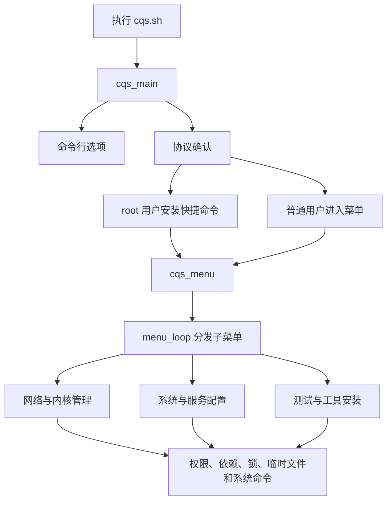
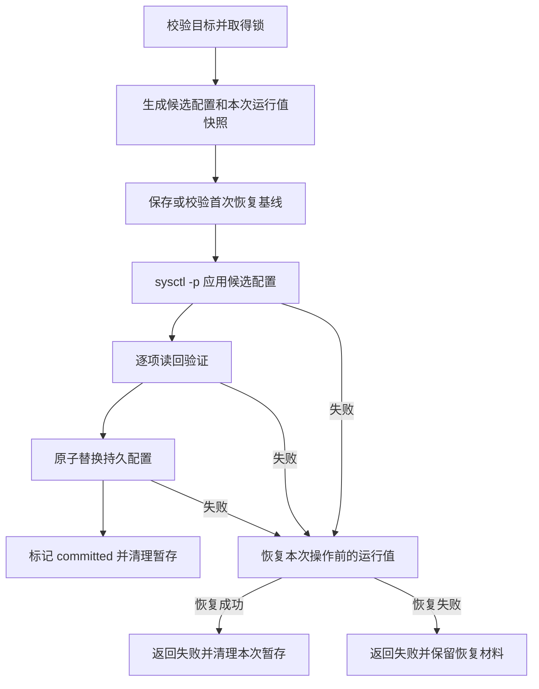

# CqShell 技术文档

本文面向维护者和部署人员，说明当前实现、状态变化、故障处理及验证方式。快速安装与功能概览见 [README](../README.md)。

- 本文对应当前源码实现，脚本版本 `0.0.1`。
- 编写日期：2026-10-26。
- 实现入口：[cqs.sh](../cqs.sh)；本文件描述已实现的行为，不代表所有功能都具备同样的回滚能力。

## 目录

- [架构与入口](#架构与入口)
- [运行环境](#运行环境)
- [配置与并发控制](#配置与并发控制)
- [网络配置事务](#网络配置事务)
- [BBR 与 TCP 调优](#bbr-与-tcp-调优)
- [第三方内核管理](#第三方内核管理)
- [SSH 与 Docker 配置](#ssh-与-docker-配置)
- [远程脚本执行](#远程脚本执行)
- [故障定位与能力边界](#故障定位与能力边界)
- [测试与验证](#测试与验证)
- [开发与维护约定](#开发与维护约定)

## 架构与入口

### 单文件分发

运行所需的项目代码集中在 `cqs.sh` 中，无需构建步骤或额外的本地 Shell 模块。Bash 负责菜单、系统命令调用和状态控制；内嵌 Python 3 处理 Release JSON、cgroup 路径和 Docker JSON。Python 代码仅使用标准库。



主要代码区域：

| 区域 | 入口或关键函数 | 职责 |
| --- | --- | --- |
| 启动与安装 | `cqs_main`、`user_agreement`、`install_shortcut` | 参数分发、协议状态、快捷命令生命周期 |
| 公共操作 | `require_root`、`require_commands`、`acquire_lock`、`menu_loop` | 权限、依赖、互斥、菜单分发 |
| 网络配置 | `network_apply_config`、`network_restore_config` | 应用、读回验证、持久化和撤销 |
| BBR / TCP | `enable_bbr`、`tcp_tune`、`calculate_tcp_buffer` | 算法检测、队列选择、缓冲区计算 |
| 内核管理 | `bbrv3_install_kernel`、`bbrv3_remove_kernel` | 下载、校验、安装、引导检查、指定版本卸载 |
| 服务配置 | `system_ssh`、`docker_set_ipv6` | 候选配置校验、服务更新与失败恢复 |
| 远程脚本 | `run_https_script` | 下载完成并检查语法后执行 |
| 综合操作 | `onekey_optimization` | 按顺序调用多个独立操作，不构成整体事务 |

### 启动契约

脚本末尾通过 `BASH_SOURCE[0]` 与 `$0` 判断是否直接执行。`source cqs.sh` 只加载变量和函数，不安装快捷命令、不写系统配置，也不进入菜单。测试使用这一入口加载实际生产代码。

| 调用 | 行为 |
| --- | --- |
| `bash cqs.sh` / `cqs` | 确认协议；root 用户安装或更新快捷命令；进入主菜单 |
| `cqs --help` / `cqs -h` | 显示帮助，不安装、不提示协议 |
| `cqs --version` | 显示项目名与版本，不安装、不提示协议 |
| `cqs --install` | 需要 root，仅执行快捷命令安装 |
| `cqs --uninstall` | 需要 root，删除快捷命令，保留下载文件与状态材料 |
| 未识别的首个参数 | 返回退出码 `2` |

协议通过后写入 `agreement.accepted`，不会修改脚本源码或自动安装软件包。状态目录按运行用户解析，因此普通用户与通过 `sudo` 运行时可能使用不同的协议状态。

`install_shortcut` 用脚本自身的真实路径定位源文件，不依赖当前工作目录。相同内容只修复执行权限；需要更新时，在目标目录生成临时文件，再以 `mv -fT` 替换。目标为符号链接或非普通文件时拒绝覆盖。

### 菜单分发

子菜单项格式为 `编号|标签|固定函数及参数`。`menu_loop` 只匹配用户输入的编号，将声明中的命令拆成数组执行，不对用户输入使用 `eval`。

菜单声明支持简单的固定参数，不是完整的 Shell 命令语言。需要管道、重定向或带空格的复杂参数时，应封装为函数。返回上级使用 `return`；子菜单遇到 `0` 或 EOF 正常返回，避免递归重新进入主菜单造成调用栈增长。

内部函数不是稳定的公开 CLI。尤其是配置辅助函数，依赖调用入口完成权限检查，不应将任意路径和参数暴露给不可信输入。

## 运行环境

支持的整体运行环境为 Debian / Ubuntu。个别传统函数保留了其他包管理器分支，这不表示整个项目支持对应发行版。

| 功能 | 主要依赖或条件 |
| --- | --- |
| 基础运行 | Bash，包含 `local -n`、数组、进程替换等能力；常见 GNU/Linux 文件工具 |
| 网络调优 | `sysctl`、`flock`、`awk`、`python3`；加载模块时需要 `modprobe` |
| 实际队列查看 | `tc`，通常由 iproute2 提供 |
| 第三方内核安装 | Debian 12+ / Ubuntu 24.04+，amd64 / arm64，root，GRUB，完整的当前内核镜像与 initramfs |
| 内核安装工具 | `curl`、`python3`、`sha256sum`、`dpkg`、`dpkg-deb`、`dpkg-query`、`apt-get`、`update-grub`、`lsinitramfs`、`systemd-detect-virt`、`flock`；UEFI 环境另需 `mokutil` |
| SSH 端口修改 | root、运行中的 `ssh.service`、`sshd`、`systemctl`、`flock`、`ss` |
| Docker IPv6 修改 | root、`python3`、支持 `--validate` 的 `dockerd`、`systemctl`、`flock` |
| 远程脚本 | `curl`、Bash；非 root 需要提权执行时还需要 `sudo` |

网络、内核和服务配置入口通常在缺少依赖时返回错误；传统测速、软件安装等流程可能自行调用包管理器安装依赖。因此不能将“缺依赖不自动安装”视为整个脚本的统一行为。

## 配置与并发控制

### 持久状态

| 变量或文件 | 默认位置 | 用途 |
| --- | --- | --- |
| `CQS_INSTALL_PATH` | `/usr/local/bin/cqs` | 安装后的快捷命令 |
| `CQS_STATE_DIR` | `${XDG_STATE_HOME:-$HOME/.local/state}/cqs` | 存放 `agreement.accepted` |
| `CQS_KERNEL_LOCK` | `/run/lock/cqs-bbrv3.lock` | 本工具内核相关操作的共享锁 |
| `CQS_KERNEL_BACKUP` | `/var/backups/cqs-bbrv3` | GRUB 操作前快照 |
| `CQS_BBR_CONFIG` | `/etc/sysctl.d/99-cqs-bbr.conf` | 拥塞算法与默认队列 |
| `CQS_TCP_CONFIG` | `/etc/sysctl.d/99-cqs-tcp.conf` | TCP 缓冲区等参数 |
| 网络恢复基线 | `<配置文件>.cqs-backup/` | 首次受管理操作前的运行值与原文件 |
| 配置锁 | `<配置文件>.cqs-lock` | 网络、SSH、Docker 配置的互斥锁 |

`CQS_*` 路径变量在脚本开头集中定义，可在启动前通过环境变量覆盖；测试用它们隔离安装、状态、网络配置和内核锁。应用、状态展示和撤销读取同一配置变量，父目录按实际目标创建。生产环境应使用可信且权限合适的绝对路径。

自有配置和恢复材料统一采用 `cqs` 命名，不自动扫描或导入其他命名的状态。升级已有部署前，先用此前版本处理未撤销的调优并结束相关进程，确认恢复材料已妥善保存后再运行新版本，避免不同版本使用不同锁或残留配置互相覆盖。不要通过删除未完成恢复的备份来完成升级。

### 锁的范围

`acquire_lock` 将文件描述符写入调用方变量，使用非阻塞 `flock -n`。相关操作在子 Shell 中持有描述符，直到操作及 `EXIT` 回退结束后释放。锁被占用时直接失败，不等待也不绕过。

- 网络应用与撤销使用同一个配置文件锁。
- SSH 与 Docker IPv6 各自使用目标配置文件锁。
- 内核安装、卸载、`system_update` 和 `system_clean` 共用 `CQS_KERNEL_LOCK`。

锁只协调使用该锁的代码路径，不协调外部 `apt`、人工编辑或其他工具。不要删除锁文件来“解锁”：旧进程仍可能持有原文件的锁，新进程却锁住另一文件，互斥将失效。

## 网络配置事务

### 应用流程

内部接口为 `network_apply_config <配置文件> <key=value>...`。只允许 `network_key_allowed` 中定义的网络参数，拒绝重复键、空值、换行值及不允许的键。



配置由 `sysctl -p` 原生解析，避免把 `tcp_rmem` 等多值参数的空格删除。读回验证会归一化空白，再比较期望值与实际值。出现部分写入、读回不一致或文件保存失败时，都不会宣布成功。

候选配置和临时文件位于目标配置附近的 `.work.XXXXXX` 目录；持久文件仅在运行参数通过验证后替换。`changed` 与 `committed` 控制退出时是否回退；`INT`、`TERM` 分别转为退出码 `130`、`143`，再由 `EXIT` 处理恢复。

这里的“原子”只指文件替换。多个 sysctl 的修改不是内核级原子操作，可能短暂部分生效；`SIGKILL`、断电和内核崩溃也无法依靠 Shell 的退出陷阱恢复。

### 两种快照

| 材料 | 内容 | 生命周期 |
| --- | --- | --- |
| `.work.XXXXXX/runtime.conf` | 本次调用前的运行值 | 用于立即失败回退；恢复失败时保留 |
| `.cqs-backup/runtime.conf` | 首次受管理操作前的运行值 | 后续成功调优不覆盖，供用户撤销 |
| `.cqs-backup/original.conf` | 首次操作前已存在的配置文件 | 撤销时恢复 |
| `.cqs-backup/no-original` | 首次操作前没有配置文件的标记 | 撤销时删除本工具创建的配置文件 |

已有基线必须完整，且参数键集合必须与新配置一致。需要管理不同参数集合时，先撤销旧配置，不能悄悄重写恢复基线。首次应用失败且立即回退成功时，会移除本次新建的基线。

### 撤销流程

`network_restore_config` 先保存撤销前的当前运行值，再恢复首次基线，随后恢复原配置文件或删除新建文件。全部完成后删除基线；撤销中途失败时，尝试回到撤销前状态，并保留原基线供重试。

撤销恢复的是记录过的状态，不是猜测发行版默认值。没有完整基线时拒绝执行。恢复失败时，以错误输出中的材料路径为准；这些文件是 sysctl 配置，不是可供 `source` 执行的 Shell 脚本。

## BBR 与 TCP 调优

### 状态、版本与队列

三个判断相互独立：

| 判断 | 数据来源 | 含义 |
| --- | --- | --- |
| BBR 可用 | `net.ipv4.tcp_available_congestion_control` | 列表中存在完整的 `bbr` 项，不把 `bbr2`、`bbrplus` 当成 `bbr` |
| BBR 已启用 | `net.ipv4.tcp_congestion_control` | 当前默认 TCP 拥塞控制为 `bbr` |
| BBR 实现版本 | `/sys/module/tcp_bbr/version` | 明确为 `1`、`2`、`3` 才显示对应版本，否则显示“未知” |

不可用时，`load_bbr_module` 尝试 `modprobe tcp_bbr`，并重新检查可用算法。模块命令成功但列表仍无 BBR，也视为失败。`modinfo` 的磁盘模块版本仅作补充信息，不作为正在运行 v3 的证明。

支持 `fq`、`fq_codel`、`fq_pie`、`cake` 四种默认队列。`apply_bbr_config` 仅管理拥塞算法和 `net.core.default_qdisc`；不会执行 `tc qdisc replace`，因此不重建现有网卡的队列树。状态页用 `tc qdisc show` 展示实际队列。选择 CAKE 也不等于已配置线路带宽整形。

Shell 参数不会把现有 BBR 实现升级成 v3。标准版与 Max 的差异来自所安装内核中的实现，运行版本 `v3` 本身也不区分这两种构建。

### 缓冲区算法

`calculate_tcp_buffer` 接收带宽 `W`（Mbit/s）、RTT `R`（ms）、有效内存 `K`（KiB），返回字节数：

```text
MiB = 1048576
BDP = W × 1000000 ÷ 8 × R ÷ 1000
候选值 = max(1 MiB, ceil(2 × BDP ÷ MiB) × MiB)
内存上限 = min(64 MiB, floor(K × 1024 ÷ 32 ÷ MiB) × MiB)
缓冲区上限 = min(候选值, 内存上限)
```

这是项目采用的启发式策略，不是内核默认值，也不保证最优吞吐。输入范围为带宽 `(0, 100000]`、RTT `(0, 10000]`，最多三位小数；有效内存至少 64 MiB。均衡模式固定以 `1000 Mbit/s、50 ms` 作为计算输入，同样受内存限制。

| 带宽 | RTT | 有效内存 | 计算结果 |
| --- | --- | --- | --- |
| 100 Mbit/s | 10 ms | 1 GiB | 1 MiB |
| 1000 Mbit/s | 80 ms | 1 GiB | 20 MiB |
| 1000 Mbit/s | 200 ms | 1 GiB | 32 MiB，受内存限制 |
| 1000 Mbit/s | 80 ms | 256 MiB | 8 MiB，受内存限制 |

`apply_tcp_profile` 将同一个结果用于发送和接收上限，并写入以下固定参数集合：

| 参数 | 值 |
| --- | --- |
| `net.core.rmem_max`、`net.core.wmem_max` | 计算出的缓冲区上限 |
| `net.ipv4.tcp_rmem` | `4096 131072 <上限>` |
| `net.ipv4.tcp_wmem` | `4096 16384 <上限>` |
| `net.ipv4.tcp_moderate_rcvbuf` | `1` |
| `net.ipv4.tcp_mtu_probing` | `1` |
| `net.ipv4.tcp_limit_output_bytes` | `1048576` |
| `net.ipv4.tcp_slow_start_after_idle` | `0` |

这里设置的是缓冲区上限，不是预分配容量；并发连接仍会共同消耗内存。配置不改写 `tcp_mem`、连接追踪、ECN、端口范围或文件描述符限制。参数的内核语义可查阅 [Linux IP sysctl 文档](https://www.kernel.org/doc/html/latest/networking/ip-sysctl.html)。

### 有效内存识别

`network_memory_kb` 用 Python 读取 `/proc/meminfo`、`/proc/self/cgroup`、`/proc/self/mountinfo`：

1. 以 `MemTotal` 为初始上限，识别当前进程的 cgroup v2 或 v1 memory 组。
2. 根据挂载根与进程组路径定位实际目录，处理 mountinfo 的八进制转义，拒绝含 `..` 的组路径。
3. 从当前组逐级检查到可见挂载根，读取 v2 的 `memory.max` 或 v1 的 `memory.limit_in_bytes`。
4. 所有数值限制与物理内存取最小值；子组的 `max` 不会取消祖先限制。
5. 无 memory controller，或可见层级没有数值限制时，使用物理内存；已声明的组无法定位、限制格式错误或读取异常时返回失败。

该值受当前进程可见的挂载命名空间限制，不代表已排查宿主机所有资源策略。函数的可选 proc 路径用于离线测试，不是线上配置来源。

## 第三方内核管理

### 安装前检查

安装入口为 `bbrv3_install_kernel`，默认 `standard`，可选 `max`。菜单另提供标准版指定 `x.y.z` 安装；包来源见 [项目参考与上游](../README.md#项目参考与上游)。

前置检查要求：root、必要命令、可识别的独立内核环境、非空 GRUB 配置、当前运行内核的镜像及 initramfs。容器、WSL 或无法确定环境时拒绝修改内核。

安装还要求 Debian 12+ / Ubuntu 24.04+ 的数字版本号，以及 amd64 / arm64 架构；缺少可用的 `VERSION_ID` 时不会按代号猜测。UEFI 环境必须能够确认 Secure Boot 已关闭。`dpkg --audit` 有输出时停止安装；检测到 `mimic/0.7.1` 时按已知兼容性问题拦截，其余 DKMS 状态会显示，安装过程不得跳过失败的钩子。

卸载保留环境与当前启动文件检查，但不采用安装专用的 Secure Boot、包审计和 DKMS 门槛，以便处理未完整安装的非运行内核。

### Release 与安装包选择

`bbrv3_release_manifest` 将 GitHub API 数据解析为纯数据清单，不作为 Shell 代码执行：

- amd64 对应 `x86_64` tag 前缀，arm64 对应 `arm64`；Max 使用 `-max` 后缀。
- 默认从最近 100 条 Release 中过滤匹配架构和类型的稳定版本，按数字版本元组取最高值，不按字符串或发布时间排序，也不遍历全部历史分页。
- 指定版本直接查询对应 tag；缺失、预发布、草稿或不匹配时失败，不回退到另一个版本。
- 必须恰好有一个匹配的 image 和一个 headers，排除错误架构、debug 与第三方 `linux-libc-dev` 包。
- 下载 URL 必须与固定发布仓库、tag、文件名完全匹配，并带有格式有效的 SHA-256 摘要。

下载后，校验真实文件摘要，再用 `dpkg-deb` 检查包名、架构和内核版本。镜像包还必须能导出目标内核配置，并声明 BBR 与 FQ 支持。

摘要保证下载内容与发布元数据相符，不是独立签名认证；仍需信任发布者及其构建链。当前内核管理不在本地编译补丁，也不执行上游安装脚本。

### 安装、引导和回退

安装与卸载从取得共享内核锁后，持续持锁到结束及失败回退完成。目标 release 与 `uname -r` 相同时拒绝覆盖，包括仅软件包 revision 发生变化的情况。

安装分两次交互确认：先确认下载，完成检查后输入 `INSTALL` 才开始修改软件包和引导。

1. 在 `CQS_KERNEL_BACKUP/boot.XXXXXX` 中保存 `grub.cfg`、`grubenv`、原文件不存在的标记及运行内核名称。
2. 使用 `apt-get install -y --no-remove` 安装本次校验的 image/headers；依赖解析仍由 apt 处理，不跳过 DKMS 或内核安装钩子。
3. 确认两包处于完整安装状态，镜像与 initramfs 非空，`lsinitramfs` 可读取，再运行 `update-grub`。
4. Hyper-V/Azure 环境额外检查必要驱动配置；配置为模块的启动必需驱动还需出现在 initramfs 中。该检查不覆盖所有云平台与所有启动设备。
5. 成功仅表示软件包与引导检查通过。脚本不自动重启，也不宣称新内核已运行；用户重启后需再次检查运行内核、网络和 BBR 版本。

安装开始后发生错误或可捕获的中断，会尝试恢复 GRUB 快照，并保留永久备份。**GRUB 恢复不是软件包事务回滚**：可能仍存在已安装或半配置的新包，需要根据 apt/DKMS 错误处理，不能直接重启。断电或 `SIGKILL` 同样无法保证执行退出处理。

### 卸载与旧内核保护

`bbrv3_remove_kernel` 仅接受已安装且未运行的 `x.y.z-joeyblog-bbrv3[-max]`。当前运行内核的软件包必须完整，启动文件必须存在。先模拟 apt purge；如计划将移除目标 image/headers 之外的软件包，拒绝继续。输入 `REMOVE` 后才备份 GRUB、卸载目标包并更新引导。

卸载失败时保留引导备份并报告错误，不自动恢复可能包含已删除内核条目的旧 GRUB 配置，也不假装恢复已卸载的软件包。

存在 `CQS_KERNEL_BACKUP` 目录，或当前运行第三方 BBRv3 内核时，`system_clean` 会跳过旧内核删除；Debian/Ubuntu 的 apt 清理同时跳过 autoremove 和孤立包卸载。这个保护不阻止管理员或其他工具删除旧内核。

## SSH 与 Docker 配置

### SSH 端口

`system_ssh` 默认修改 `/etc/ssh/sshd_config`，接受 1–65535 的整数端口并按十进制规范化。它要求 `ssh.service` 已运行，拒绝 `ssh.socket` 接管监听的环境，也不会为了修改端口主动启动原本关闭的 SSH 服务。

取得配置锁后，保留原文件和权限，构建仅更改全局 `Port` 的候选文件，保留 `Match` 与 `Include`。候选必须通过：

1. `sshd -t` 语法检查。
2. `sshd -T` 展开检查，实际端口集合只能包含目标端口。
3. `ListenAddress` 不得固定为其他端口。

替换后 reload 服务，确认服务仍 active，并最多轮询约 5 秒：由 `systemctl` 获取的 SSH 主进程 PID 必须实际监听目标端口，不能把其他进程的监听当成成功。失败时恢复原文件并尝试 `reload-or-restart`；恢复失败则保留工作目录。

该检查不代表外部网络可达，不自动放行防火墙，也不代表客户端已能通过新端口登录。密钥登录功能 `system_keygen` 是另一条传统路径，不继承此事务保证。

### Docker IPv6

`docker_set_ipv6` 使用 Python 合并 `/etc/docker/daemon.json`，保留数据目录、日志和镜像源等无关字段：

- 启用时设 `ipv6=true`；已有 `fixed-cidr-v6` 或 `bip6` 时保留，否则生成 ULA 子网。
- 关闭时设 `ipv6=false`，删除 `fixed-cidr-v6`、`bip6`、`default-gateway-v6`。
- 候选必须通过 `dockerd --validate`，再替换文件、重启 Docker 并检查 active 状态。

失败时恢复原文件；原来没有配置文件则删除本次新建文件。服务原本运行则尝试重启恢复，原本关闭则停止服务。恢复失败会保留备份路径。成功操作会重启 Docker，即使它原本未运行。

生成 ULA 子网不等于配置了公网 IPv6 路由，服务 active 也不等于容器端到端网络已经验证。镜像源修改 `docker_mirrors` 目前不复用此 JSON 事务流程。

## 远程脚本执行

`run_https_script` 依次检查 URL、完整下载、非空内容和 Bash 语法，之后才执行文件。curl 限制请求及重定向协议为 HTTPS，设置 15 秒连接超时与 300 秒总超时；远程脚本的退出状态向上传递。

当前带宽测速安装器、IP 检测、路由测试、性能测试及 Docker 安装入口使用该辅助函数。它不固定远程内容摘要，不验证独立签名，也不隔离被执行脚本的权限。语法正确不等于行为可信；在 root 主程序中执行的脚本仍具有 root 权限。

此约束不代表所有 HTTP 请求或内嵌安装器都采用相同策略；例如系统信息查询及 Starship 内嵌安装逻辑有各自的实现。

## 故障定位与能力边界

### 常见定位方向

| 现象 | 检查方向 |
| --- | --- |
| BBR 版本未知 | 检查运行内核是否暴露 sysfs 版本，不用磁盘模块版本替代运行证据 |
| 默认队列已更改，但实际队列未变 | 查看 `tc qdisc show`；默认参数不会自动重建现有队列树 |
| 网络参数应用或读回失败 | 检查失败键、内核支持、容器权限和其他配置写入；使用错误中保留的快照定位 |
| 配置正在被其他进程修改 | 等待持锁操作结束，不删除锁文件绕过互斥 |
| 内核安装中断或 DKMS 失败 | 查看 apt/DKMS 原始输出、`dpkg --audit` 和引导备份；修复前不要重启 |
| SSH 新端口未验证成功 | 检查 socket 激活、Include、ListenAddress 和实际监听进程；不要继续关闭密码登录 |
| Docker IPv6 修改失败 | 检查 JSON、`dockerd --validate` 和服务状态；注意是否报告恢复失败 |

可用于收集状态的只读命令：

```bash
uname -r
sysctl net.ipv4.tcp_congestion_control net.core.default_qdisc
tc qdisc show
dpkg --audit
```

### 尚未统一的行为

当前实现不能被概括为“所有系统操作都已事务化”：

- `system_clean` 会清理日志、缓存和 Docker 数据，不能通过网络或 GRUB 快照恢复这些删除。
- SWAP、fail2ban、密钥登录、Docker 镜像源和 Docker 卸载等传统路径尚未统一纳入上述配置事务。
- `system_keygen` 及一键优化末尾会输出私钥内容；运行记录不能作为普通日志公开分享，后续维护应优先收敛这一行为。
- `onekey_optimization` 在系统更新、清理函数返回失败或 SSH 端口修改失败时停止；TCP/BBR 失败会记录并继续。其他部分步骤仍有直接输出成功提示的传统实现，因此结尾提示不能证明全部子操作成功。
- 一键优化使用均衡 TCP 参数和现有内核的 BBR，不自动安装第三方内核，也不提供整组操作的统一撤销。

这些是源码基线的实际边界，不是已完成的修复承诺。部署验收仍需验证服务、网络和启动结果。

## 测试与验证

### 运行方式

在 Linux / WSL 的项目根目录运行，不需要用 root 执行测试：

```bash
bash -n cqs.sh
python3 -B -m unittest discover -s tests -v
```

推荐使用 Debian 12+ / Ubuntu 24.04+ 的开发环境，以满足涉及发行版判断的测试分支。测试依赖 Python 3、Bash、常用文件工具、`flock` 和 `dpkg-deb`；HTTPS 测试另需 `curl`、`openssl`。Windows 原生 Python 下会跳过 Linux 专用测试，不应把跳过结果当成通过。

只运行内核管理测试：

```bash
python3 -B -m unittest discover -s tests -p 'test_bbr_kernel.py' -v
```

### 覆盖范围

[shell_support.py](../tests/shell_support.py) 通过 `source` 加载实际脚本；需要函数文本时使用 Bash 的 `declare -f`，不依赖正则截取函数。

| 测试文件 | 主要覆盖 |
| --- | --- |
| [test_app_structure.py](../tests/test_app_structure.py) | source 无启动副作用、CLI、协议状态、快捷命令、菜单分发与返回 |
| [test_bbr.py](../tests/test_bbr.py) | BBR 检测、参数应用/恢复、真实锁竞争、BDP 计算、原生 sysctl 解析 |
| [test_bbr_kernel.py](../tests/test_bbr_kernel.py) | Release 筛选、包校验、拒绝覆盖运行内核、共享锁、安装失败与卸载边界 |
| [test_config_safety.py](../tests/test_config_safety.py) | SSH/Docker 校验、服务失败、配置恢复和符号链接目标保护 |
| [test_https_downloads.py](../tests/test_https_downloads.py) | 本地 TLS 服务与真实 curl，验证降级跳转、残缺下载、语法错误和退出状态 |
| [test_memory_limits.py](../tests/test_memory_limits.py) | 合成 proc/cgroup 层级，验证子组、祖先、挂载根与非法路径 |
| [test_native_config.py](../tests/test_native_config.py) | 使用真实 sshd/dockerd 校验候选配置，不启动真实服务 |

测试用临时目录和明确的系统命令替身隔离写操作。内核测试会用真实 `dpkg-deb` 构建和检查测试包，但不会安装或启动这些包；原生 sysctl 检查使用 `--dry-run`。

可选的原生验证工具从 PATH 查找，也可通过 `CQS_TEST_SSHD`、`CQS_TEST_DOCKERD` 指定可执行文件。SSH 测试另需 `ssh-keygen`；缺少工具或 `sysctl --dry-run` 时会明确跳过相应测试。原生服务测试故意让 reload/restart 失败，以检查解析与恢复流程，不证明服务切换已通过。

### 验证记录与实机验收

当前源码最近一次验证环境为 x86_64 WSL Debian，日期 2026-10-26：Bash 语法检查通过；101 项测试中 98 项通过，3 项因缺少原生 sshd/dockerd 跳过。此处为本次验证记录，后续以实际测试输出为准。

以下工作不能由该记录替代：真实第三方内核安装与重启、不同硬件/云平台启动、arm64 实机运行、SSH 外部连接、容器 IPv6 连通性以及实际线路吞吐和延迟测试。WSL 可执行自动化检查，但本项目主动拒绝在 WSL 内安装、卸载第三方内核。

## 开发与维护约定

1. 保持 `cqs.sh` 单文件分发；只加载定义的 source 行为是测试契约，不能在顶层增加安装、联网或配置写入。
2. 新子菜单使用 `menu_loop` 和固定函数调用；复杂操作放到函数中，避免递归调用主菜单或解释用户输入为 Shell 命令。
3. 修改状态的入口先校验权限和依赖。涉及网络配置时复用参数白名单、文件锁、运行值快照及读回验证，不通过 `|| true` 把失败包装成成功。
4. 文件提交与运行状态变化分别考虑。清楚定义哪些内容可恢复、失败后保留哪些材料，以及哪些外部操作不受本工具锁控制。
5. 自有路径使用 `cqs` 命名并集中定义；调整参数集合或状态布局时，同步说明升级流程，避免并发锁和恢复基线失配。
6. 测试应覆盖拒绝路径与部分失败，命令替身只证明控制流程；涉及平台解析时尽量补充原生工具验证，明确标注跳过与未执行的实机检查。
7. 脚本保持 LF 换行，仓库的 [.gitattributes](../.gitattributes) 已为 `*.sh` 设置规则。修改实现时同步更新本文件，README 继续聚焦快速开始与核心功能。

项目来源与署名统一列在 [README 的项目参考与上游](../README.md#项目参考与上游)；许可文本见 [LICENSE](../LICENSE)。
